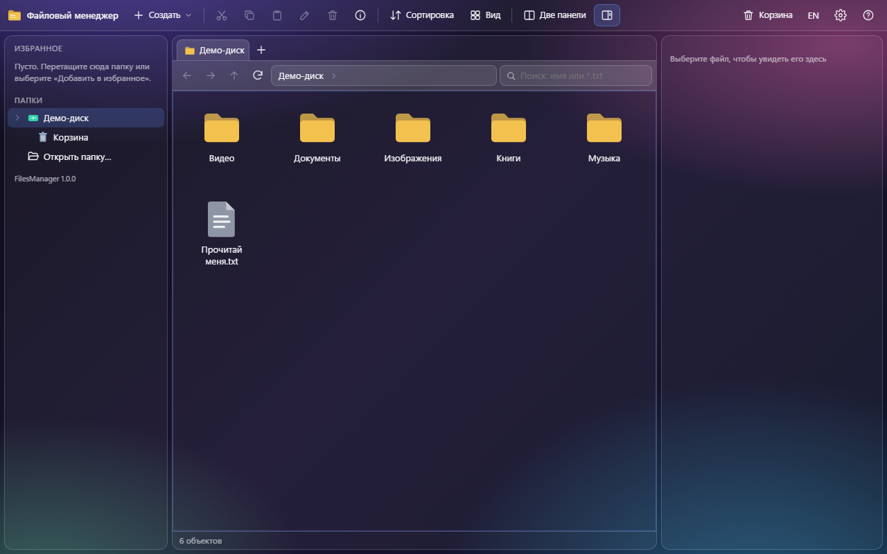
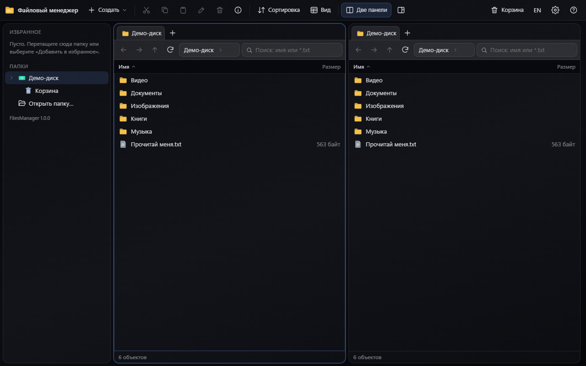
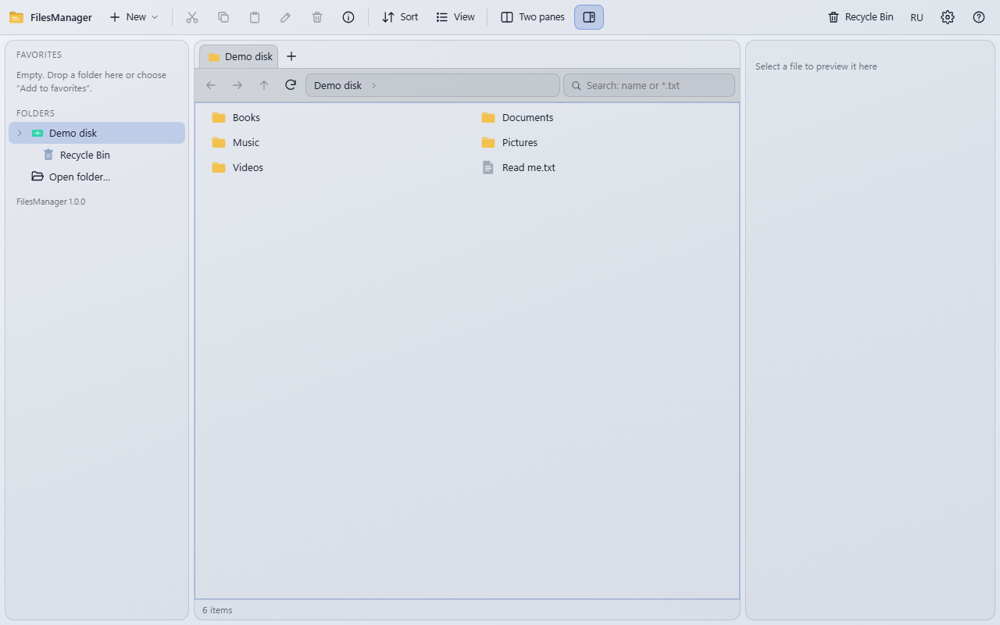
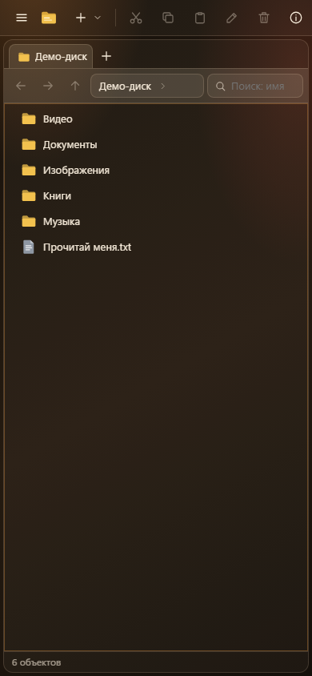

<div align="center">


# Файловый менеджер

**Файловый менеджер (FilesManager) - проводник в одной HTML-странице: дерево папок, вкладки, две панели, поиск по маске, просмотр файлов и горячие клавиши Проводника Windows. Есть программа для Windows на Electron, которая работает с настоящим диском. Удалять безвозвратно она не умеет: всё уходит в Корзину.**

[**▶ Открыть на сайте (демо-диск) →**](https://alexalesha.github.io/FilesManager/) &nbsp;·&nbsp; [Скачать для Windows](https://github.com/ALEXalesha/FilesManager/releases/latest) &nbsp;·&nbsp; [English version of this file](README.md)

[](#) [](https://github.com/ALEXalesha/FilesManager/releases/latest) [](https://github.com/ALEXalesha/FilesManager/actions/workflows/ci.yml) [](LICENSE) [](https://developer.mozilla.org/docs/Web/HTML) [](https://www.electronjs.org/) [](https://alexalesha.github.io/FilesManager/) [](https://claude.com/claude-code)

Код, тесты и документация этого проекта написаны Claude (Anthropic) в Claude Code. Идеи, проверка и решения - Алексей.

</div>

Интерфейс на русском и английском (кнопка RU/EN в шапке).





## Где какие файлы видит

| Где открыт | Что видит | Куда уходит удалённое |
|---|---|---|
| Программа для Windows | весь диск, через главный процесс Electron | Корзина Windows (`shell.trashItem`) |
| Chrome, Edge (сайт или `index.html`) | демо-диск в IndexedDB браузера и папки, открытые кнопкой «Открыть папку...» (File System Access API) | Корзина программы: папка `.files-manager-trash` внутри открытой папки, у демо-диска - своя |
| Firefox, Safari | только демо-диск (File System Access API там нет) | Корзина демо-диска |

Демо-диск - это пять папок и файл «Прочитай меня.txt» в IndexedDB этого браузера. На сайте можно создавать, переименовывать, копировать и удалять что угодно: настоящих файлов страница не касается.

## Почему так устроено

- **Удаление только в Корзину.** В мосте между страницей и диском (`electron/preload.js`) функции безвозвратного удаления нет совсем, и закон программы это проверяет: среди имён `window.fmNative` не должно быть `rm`, `remove`, `unlink`, `rmdir`, `purge`, `delete`. В Проводнике Shift+Del удаляет навсегда, здесь он тоже кладёт в Корзину и говорит об этом в окне подтверждения. «Удалить навсегда» есть только внутри Корзины самой страницы в браузере, где Корзины Windows нет.
- **Перенос между дисками = копия + исходник в Корзину.** Переименование между томами Windows не работает (`EXDEV`), а «скопировать и стереть» оставляет без исходника, если копия оборвалась. Здесь исходник сначала копируется, потом уходит в Корзину, и его можно вернуть.
- **Все операции с диском в главном процессе.** Страница не получает ни `fs`, ни Node: она шлёт 18 запросов (`fm:list`, `fm:copy`, `fm:trash`, `fm:search` и другие) через `ipcMain.handle`, а главный процесс проверяет пути и делает работу.
- **Одна страница на сайт и программу.** Программа открывает тот же `index.html` (в установке он лежит как `resources/web/index.html`), второй копии нет. Без `window.fmNative` страница сама переходит на демо-диск.
- **Ошибки с диска - простым объектом.** Error, переданный через `contextBridge`, теряет поле `code` (остаётся только текст), и страница не могла отличить «уже есть» (`EEXIST`) от «нет доступа». Мост отдаёт отказ объектом `{name, code, message}`.

## Что умеет

- **Вид:** плитки, список, таблица (Ctrl+Shift+1...8, как в Проводнике), сортировка по имени, дате, типу, размеру, скрытые файлы и расширения по выбору.
- **Вкладки и две панели:** Ctrl+T / Ctrl+W, Ctrl+Tab, Ctrl+\ - вторая панель, Tab - между панелями, Shift+F5 / Shift+F6 - копировать / перенести в другую панель.
- **Поиск:** по маске (`*.txt`, `отчёт*`) во всех вложенных папках, с отменой.
- **Просмотр:** картинки, текст и код с подсветкой, аудио, видео, PDF - в области справа (Alt+P или Пробел) и в окне (Enter или двойной щелчок), стрелки - к соседнему файлу.
- **Вид окна:** пять тем (Стеклянная, Строгая, Светлая, Ночная, Тёплая - те же, что в Paint Pro), работает на телефоне.
- **Память:** настройки в `localStorage` (ключи `files-manager.*`); если хранилище закрыто, страница всё равно работает. Программа помнит размер и место окна.



### Пределы

| Что | Предел | Зачем |
|---|---|---|
| Текст в области просмотра | 256 КБ | выбор большого лога не должен подвешивать страницу |
| Текст в окне просмотра | 2 МБ | то же для окна |
| Подсветка кода | 300 КБ | дальше - простой текст: подсветка большого файла заметно тормозит |
| Найденное в поиске | 10 000 | список длиннее искать уже не помогает |
| Миниатюры картинок в плитках | до 40 МБ | крупнее - значок, без чтения файла целиком |

### Клавиши

| Клавиша | Действие |
|---|---|
| Alt+← / Alt+→ / Alt+↑, Backspace | назад / вперёд / вверх; назад |
| Enter, Ctrl+Enter | открыть; папку - в новой вкладке |
| F2 | переименовать |
| Del, Ctrl+D, Shift+Del | в Корзину |
| Ctrl+C / Ctrl+X / Ctrl+V | копировать / вырезать / вставить |
| Ctrl+Shift+C | копировать путь |
| Ctrl+Shift+N / Ctrl+Alt+N | новая папка / новый файл |
| F3, Ctrl+F, Ctrl+E | поиск |
| F4, Ctrl+L, Alt+D | адресная строка |
| F5, Ctrl+R | обновить |
| Alt+Enter | свойства |
| Shift+F10, клавиша меню | контекстное меню |
| буквы | переход к имени (набранное за секунду - начало имени) |
| F1 | справка по клавишам |



## Запуск у себя

- **Браузер:** откройте `index.html` в Chrome или Edge. Всё внутри файла (около 245 КБ), ничего не скачивается.
- **Программа для Windows:** `FilesManager-<версия>-Setup.exe` (ставится для текущего пользователя) или `FilesManager-<версия>-Portable.exe` (без установки) в [Releases](https://github.com/ALEXalesha/FilesManager/releases). Версия - в заголовке окна.
- **Из исходников:** `npm install`, потом `npm start` (программа) или `npm run dist` (установщик и portable в `electron/dist`).

## Проверки

```
npm install
npx playwright install chromium
npm run test:page              # законы страницы на демо-диске
npm test                       # и закон программы Electron (окно скрыто)
node tests/mutate.js           # проверка проверок: сломанные копии страницы должны ронять законы
```

Законы страницы открывают `index.html` по файловому адресу в безголовом Chromium и работают только с демо-диском. Закон программы запускает настоящий Electron со скрытым окном (`FM_TEST=1`) на временной папке (`FM_START`): создаёт, переименовывает, копирует, ищет, кладёт в Корзину Windows один временный файл и открывает папку и файл двойным щелчком мыши. Кадры выше сняты без окна скриптом `tools/screenshots.js`.

Находка первой проверки: строка-пример с `</script>` внутри встроенного скрипта закрывала тег раньше времени. HTML-парсер ничего не знает о строках JavaScript: он видит `</script>` и обрывает скрипт там. Страница не запускалась вовсе и не писала ни одной ошибки о своём коде, только синтаксическую в обрывке. Теперь там `<\/script>`, а законы страницы падают на любой ошибке в консоли.

Находка 1.0.1: двойной щелчок по папке её не открывал. Замер показал почему: первый щелчок выделяет папку и перерисовывает список, а щелчок между двумя нажатиями перерисовывал его ещё раз. Событие `dblclick` браузер отдаёт тому элементу, на который пришлось второе нажатие, а он к этому времени уже убран со страницы (`isConnected` = false) - событие не доходит ни до списка, ни даже до `document`. Теперь папка или файл открываются на втором нажатии мыши (`mousedown` с `detail === 2` по тому же элементу), пока элемент под мышью живой, - так же делает Проводник. Закон щёлкает настоящей мышью (`page.mouse.dblclick`) во всех видах, в обеих панелях, в результатах поиска и в дереве, и отдельно в программе Electron.

Находки независимой проверки 1.0.2: в окне шириной 560-1120 px правый край панели команд (язык, «Настройки», «Справка») уходил за окно, а полоса прокрутки у панели скрыта - мышью до этих кнопок было не добраться. Теперь панель сама убирает подписи, а если и без них не влезает - встаёт в две строки. При двух панелях в окне 720-1000 px поле поиска уходило за край своей панели; теперь узкая панель ужимает строку навигации, а совсем узкая ставит поиск отдельной строкой. Закон проверяет 13 размеров окна, оба языка, одну и две панели. Мутационный скрипт `node tests/mutate.js` ломает 6 правил в копии страницы.

Мелочи 1.0.3: вкладки и открытая папка сохраняются сразу (раньше через 200 мс - новая вкладка терялась, если сразу закрыть окно); кнопка `>` в строке адреса открывает меню папок и на демо-диске (раньше тот же щелчок его закрывал) и получила подсказку; после щелчка по кнопке панели команд, заголовку столбца, вкладке, адресу или пункту меню клавиатура снова управляет списком файлов; рамку фокуса заголовка столбца больше не срезает. Мутационный скрипт ломает 13 правил.

## История

Файловый менеджер сделан в сборнике [Hub](https://github.com/ALEXalesha/ALEXalesha.github.io) (папка `web/files-manager`), где он - программа в разделе «Программы» Хаба. Этот репозиторий несёт его вместе с историей коммитов. Изменения по версиям - в [CHANGELOG.md](CHANGELOG.md).

## Лицензия

MIT, см. [LICENSE](LICENSE).
